<!--
  ==========================================================================
  GITHUB PROFILE README — Niraj Chavan  (terminal style, like the Short)
  Repo: Niraj-Chavan/Niraj-Chavan — put README.md + terminal-header.svg
        (+ portrait.svg once generated) at repo root, branch: main
  --------------------------------------------------------------------------
  VERIFIED 2026-10-14 — do not change numbers without re-checking:
  LeetCode   Nirajchavan  — 752 solved (306E / 386M / 60H)
  Codeforces _nirajc7     — 106 solved, max rating 1131
  CodeChef   cool_dell_71 — rating 1572, peak 1576, 8 contests
  LinkedIn   niraj-chavan-2a2442311
  Email      niraj.chavan24@vit.edu
  --------------------------------------------------------------------------
  NO PUBLIC REPO YET: SeeTheScience — add only after code is pushed.
  ==========================================================================
-->

  

  

  
  
  
  

---

## About

I'm a Computer Science student at Vishwakarma Institute of Technology (CGPA 9.09/10) who likes
the part of ML where the hard engineering lives — training pipelines, data that can't leave the
hospital, and models that still work when the network doesn't.

My work sits at the intersection of **AI systems and privacy**: federated training across
distributed datasets, on-device inference, and educational tools that verify their own answers
instead of just asserting them.

- **Primary language:** C++ — also Python, JavaScript, SQL
- **Currently building:** federated learning, neuro-symbolic tutoring, offline-first AI
- **Currently learning:** advanced DSA, LLM internals, differential privacy
- **Looking for:** SDE / ML internships

---

## Tech stack

| Area | Tools |
| --- | --- |
| **Languages** | `C++` `Python` `JavaScript` `SQL` |
| **ML / AI** | TensorFlow · Keras · scikit-learn · OpenCV · MobileNetV2 · EfficientNetB4 · ResNet50V2 · Flower |
| **LLM systems** | Gemini API · OpenAI · Anthropic · Groq · Hugging Face |
| **Backend & data** | FastAPI · Flask · Node.js · Express · REST APIs · PostgreSQL · MongoDB · SQLite |
| **Core CS** | Data Structures & Algorithms · OOP · DBMS · Operating Systems |
| **Tooling** | Git · GitHub · Linux · Google Colab · Streamlit · SUMO |

---

## Featured projects

### 1. Federated Learning — Privacy-Preserving Autism Detection
> Collaborative model training across distributed clinical datasets **without centralizing patient data**.

Tuned MobileNetV2 and EfficientNetB4 under federated aggregation with Flower, reaching **90.2%**
and **85%** classification accuracy on cross-cultural autism datasets. Built a multi-site pipeline
with secure client-server communication — raw images never leave the client — and benchmarked
multiple architectures across heterogeneous clients.

*Research project. Not a clinical tool; no diagnostic claims.*

`Python` `TensorFlow` `Keras` `OpenCV` `Flower`
[Repository](https://github.com/Niraj-Chavan/EDI-autistic)

### 2. Neuro-Symbolic AI Tree Tutor
> An AI tutor for the data structures that usually click for students too late.

Covers AVL, Red-Black, heaps, segment trees, B-trees and B+ trees. Pairs a **symbolic validator**
(checking each operation is structurally correct) with D3 visualizations, misconception detection,
and AI-generated explanations — so the model's explanation can't drift from the true state of
the tree.

`React` `D3.js` `FastAPI` `Python` `Gemini API` `SQLite`
[Repository](https://github.com/Niraj-Chavan/nuerosymbolic-agentic-ai)

### 3. SmartCare — Offline-First Symptom Checker
> A PWA that keeps working after the network is gone.

Offline-first progressive web app for low-connectivity environments. After the first visit it
loads, matches symptoms, scores risk and shows guidance entirely on-device, using a local medical
knowledge base in IndexedDB. Local rule-based scoring instead of a cloud call keeps it fast,
private, and deployable where connectivity is unreliable.

`React` `Vite` `Tailwind CSS` `JavaScript` `IndexedDB` `PWA`
[Repository](https://github.com/Niraj-Chavan/SMARTCARE-AN-offline-First-AI-system)

### 4. Driver Drowsiness Detection
> Real-time eye-state classification from a webcam, with alerts before it's too late.

Trained a ResNet50V2 classifier on eye state and wired it into a live OpenCV pipeline — face
detection, frame preprocessing, inference, alerting — tuned for low-latency webcam inference.
Shipped as a responsive Flask app with a Tailwind frontend usable from any browser.

`Python` `Flask` `TensorFlow` `ResNet50V2` `OpenCV` `Tailwind CSS`
[Repository](https://github.com/Niraj-Chavan/driver-drowsiness-detection)

<b>More work</b>

- **[projectDAA](https://github.com/Niraj-Chavan/projectDAA)** — ERA* + GLP AI-assisted emergency
  vehicle routing with a green corridor, simulated in SUMO on a Pune map.
- **[bcb-estimator](https://github.com/Niraj-Chavan/bcb-estimator)** — automated estimate generator
  for Elliptical K.T. Weirs for the Maharashtra Soil & Water Conservation Department.

---

## Problem solving

| Platform | Profile | Verified |
| --- | --- | --- |
| LeetCode | [Nirajchavan](https://leetcode.com/u/Nirajchavan/) | **752 solved** — 306 Easy · 386 Medium · 60 Hard |
| CodeChef | [cool_dell_71](https://www.codechef.com/users/cool_dell_71) | **1572** rating (peak 1576), 8 rated contests |
| Codeforces | [_nirajc7](https://codeforces.com/profile/_nirajc7) | 106 solved |

> **Achievement:** 1st Runner-Up — Hacktovate, CODEFLIX'26 (CSI VIT Pune), institute-level hackathon.

---

## GitHub activity

<picture>
  <source media="(prefers-color-scheme: dark)" srcset="https://github-readme-stats.vercel.app/api?username=Niraj-Chavan&show_icons=true&hide_border=true&theme=transparent&rank_icon=github">
  <source media="(prefers-color-scheme: light)" srcset="https://github-readme-stats.vercel.app/api?username=Niraj-Chavan&show_icons=true&hide_border=true&theme=transparent&rank_icon=github">
  
</picture>

<!-- If either widget above ever breaks, delete this whole block — nothing else depends on it. -->

---

## Research interests

- **Federated learning & privacy-preserving AI** — training where the data already lives
- **Trustworthy systems** — verifiable outputs, not just fluent ones
- **Computer vision** for assistive and safety-critical applications

---

## Connect

- **Email** — [niraj.chavan24@vit.edu](mailto:niraj.chavan24@vit.edu)
- **LinkedIn** — [niraj-chavan-2a2442311](https://www.linkedin.com/in/niraj-chavan-2a2442311/)
- **GitHub** — [@Niraj-Chavan](https://github.com/Niraj-Chavan)

Open to SDE and ML internships, research collaboration, and anything involving algorithms,
privacy, or software that has to work offline.
